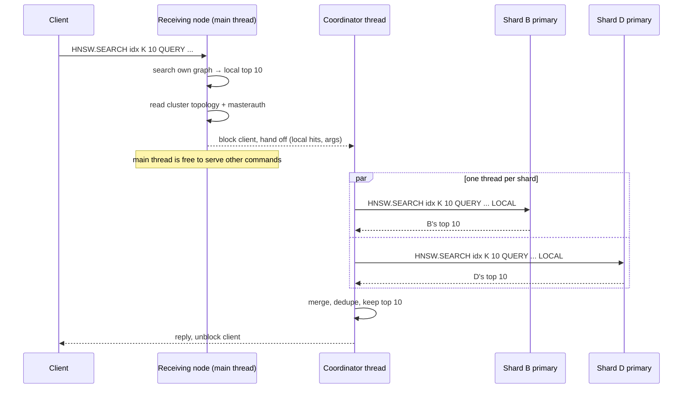

# Searching a Redis Cluster

In a cluster, each shard keeps its own HNSW graph over the vectors it stores ([README: Redis Cluster](../Readme.md#redis-cluster)). Searching the whole index therefore means asking every shard and merging their answers. That can happen in two places:

* **In the module (default):** send `HNSW.SEARCH` to any node. That node coordinates the search across the cluster.
* **In the client:** send `HNSW.SEARCH ... LOCAL` to every primary yourself and merge the replies. [`client/hnsw_cluster.py`](../client/hnsw_cluster.py) does this with `search(..., fanout="client")`.

Both build on the same fact. Each shard returns its own top K, so the global top K is always among those per-shard results. Both return the same results, and [`client/test_cluster.py`](../client/test_cluster.py) checks this on every primary and every replica.

## How the in-module coordinator works

The code is `search_knn` in [`src/lib.rs`](../src/lib.rs) and [`src/coordinator.rs`](../src/coordinator.rs).

### On the main thread

1. **Parse.** Any `LOCAL` token after the index name is removed and remembered. An index that is itself named `local` is not affected.
2. **Search locally.** The node searches its own graph right away. Graphs are only ever touched on the Redis main thread, so the background thread never reads one.
3. **Decide whether to fan out.** The node returns its local results directly in any of these cases:
   * `LOCAL` was given.
   * The server isn't in cluster mode.
   * There is no other shard.
4. **Find the other shards.** The node reads its own view of the cluster (`RedisModule_GetClusterNodesList` / `GetClusterNodeInfo`) and takes every primary except the one for its own shard:
   * A primary skips itself.
   * A replica skips its own primary, because the replica's graph already covers that shard. This is why `HNSW.SEARCH` works on a replica after `READONLY`.
   * The node errors out if a primary has no usable address.
5. **Refuse where it can't block.** Inside `MULTI`, a Lua script or a function, Redis doesn't let a command block, so the node returns an error that asks for `LOCAL`.
6. **Read the credentials** (`CONFIG GET masteruser` / `masterauth`), so they're ready for connecting to the other nodes.
7. **Block the client and hand off.** The client waits for its reply, but the node goes back to serving everyone else.

### On the coordinator thread

1. **Query the shards in parallel.** One short-lived thread per remote shard sends `HNSW.SEARCH <original args> LOCAL`. The original argument bytes are forwarded unchanged, so the query vector isn't re-formatted.
2. **Connections.** The module speaks plain RESP2 over TCP using a small built-in client.
   * Connections are pooled per node, up to 8 idle ones each.
   * A new connection sends `AUTH [masteruser] masterauth` first, when `masterauth` is set.
3. **Timeouts and retries.**
   * Connecting, writing and reading each have a 5-second limit (`coordinator::TIMEOUT`).
   * A pooled connection that turns out to be closed (for example after the remote node restarted) is retried once on a fresh connection.
   * A timeout is not retried. The shard is slow rather than gone, and a retry would only double the wait.
   * A connection that failed in any way is thrown away, so a late reply can never be read as the answer to the next query.
4. **All-or-nothing.** If any shard fails, the whole search fails with an error such as `HNSW.SEARCH failed on shard 10.0.0.3:6379: timed out after 5s`. A search never silently returns results that are missing a shard.
5. **Merge.** The local and remote lists are combined:
   * A key seen on two shards keeps its best similarity. This happens while a slot is migrating.
   * Results are sorted by similarity (ties by name) and cut to K.
6. **Reply.** The thread sends the reply through a thread-safe context, which unblocks the client.

### Reply format

The reply has the same format as a local search: the number of hits, then one `[similarity, <sim>, name, <key>]` array per hit, best first. Callers can't tell whether a reply was coordinated or local.

## How the client-side approach works

`HnswCluster.search(..., fanout="client")` in [`client/hnsw_cluster.py`](../client/hnsw_cluster.py) works like this:

1. It takes the list of primaries from redis-py's cluster map.
2. It sends `HNSW.SEARCH ... LOCAL` to each primary in parallel, using a thread pool.
3. It merges the replies the same way the module does: best similarity per key, sorted, top K.

The search commands themselves are the same as in the module. Only where the fan-out and merge run is different.

## Comparison

| | In-module coordinator | Client-side fan-out |
|---|---|---|
| **What the client sends** | One `HNSW.SEARCH` to any node | `HNSW.SEARCH ... LOCAL` to every primary |
| **What the client needs** | Nothing special. Works from `redis-cli` and any client library | Cluster-aware client, plus merge code in every language you use |
| **Network path** | Client → node → shards (one extra hop, inside the cluster) | Client → shards directly |
| **Work on the server** | The receiving node also merges and runs a thread per remote shard | Each shard only runs its local search |
| **Which nodes are searched** | Always the primaries of the other shards. The receiving node can be a replica | Whatever the client picks. The reference client uses primaries |
| **Topology** | The node's own cluster view, kept current by the cluster bus | The client's cached slot map (see below) |
| **Failures** | All-or-nothing, fixed 5s timeout per shard | Your choice: fail, retry, or accept partial results, with your own timeouts |
| **Credentials** | The cluster's `masteruser`/`masterauth` | The client's own user and password |
| **TLS** | Not supported | Whatever the client supports |
| **`MULTI`, scripts, functions** | Not allowed; use `LOCAL` | Works (each `LOCAL` call is an ordinary command) |
| **Results** | Identical | Identical |

### Where the differences matter

**Stale topology.** `LOCAL` searches don't involve any keys, so they never get a `MOVED` redirect. redis-py only refreshes its cluster map after redirects or connection errors. So after a shard is added, or after a failover that leaves the old primary reachable as a replica, a client-side fan-out can keep using an outdated primary list until something else forces a refresh. With a new shard, that silently leaves out the vectors moved to it. The in-module coordinator reads the current cluster view on every query, so it doesn't have this problem.

**Credentials and permissions.** The coordinator connects to other nodes as the replication user (`masteruser`, or the default user with `masterauth`). A client that may run `HNSW.SEARCH` can therefore cause `HNSW.SEARCH ... LOCAL` to run on other shards under that identity. The remote command is always the search itself, never something the caller chooses, but if your ACLs separate users per shard, this crosses that line. Use the client-side fan-out in that setup, or in any setup that needs TLS between nodes.

**Timeouts.** The coordinator gives each shard 5 seconds. Configure clients with a socket timeout longer than that. Otherwise the client gives up first, and if it retries automatically (redis-py does), the retry can succeed after the slow shard recovers, which hides the fact that the shard stalled. With client-side fan-out, you set the timeout directly on each shard call.

**Load.** In-module coordination puts the merge, the outgoing connections and one thread per remote shard on whichever node receives the query. Spread queries across nodes, as cluster clients do for keyless commands, so no single node does all the coordinating. Client-side fan-out keeps that work in the application tier.

**Latency.** The in-module path adds one hop: client to node, then node to shards. Traffic between nodes is usually on a faster network than traffic from the client, and the receiving node's own shard costs no network round trip at all, so in practice the two are close. Measure it if it matters to you.

### Behaviour both approaches share

* **No snapshot.** Shards are searched at slightly different moments. While a slot is migrating, a key can be seen on both shards (deduplicated) or, rarely, on neither (moved between the two searches).
* **Recall.** Each shard searches with `ef = max(EFCON, K)` over its own graph. Splitting an index into smaller graphs and taking the union of their top K usually gives recall at least as good as one large graph, at the cost of one search per shard.
* **Cost per query.** K results from each of S shards are transferred and merged: O(S·K).

## Which one to use

Use the **in-module coordinator** by default. It's one command from any client, it always sees the current topology, and a missing shard can't go unnoticed.

Use the **client-side fan-out** when any of these apply:

* the nodes need TLS between them
* per-user ACLs must hold on every shard
* you want partial results or your own timeout and retry policy
* you search inside `MULTI` or scripts
* you want the coordination work off the Redis nodes

## Limitations of the current implementation

* One thread is started per remote shard per query. A fixed worker pool would be cheaper under heavy query load.
* The 5-second timeout is a constant, not a configuration setting.
* No TLS for connections between nodes.
* Addresses come from the cluster's announced IP and client port. A cluster that announces only hostnames isn't supported.
